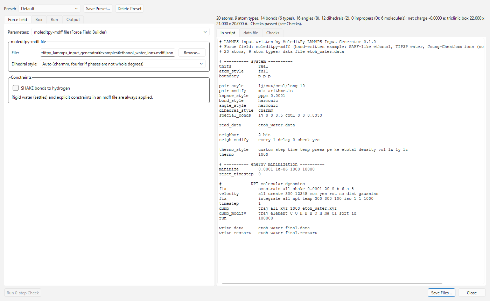
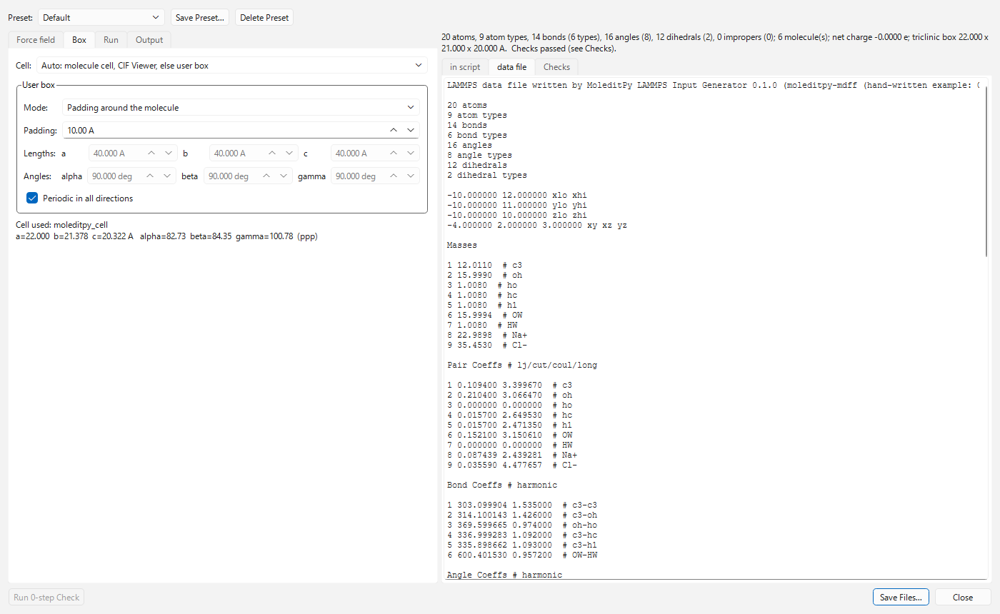
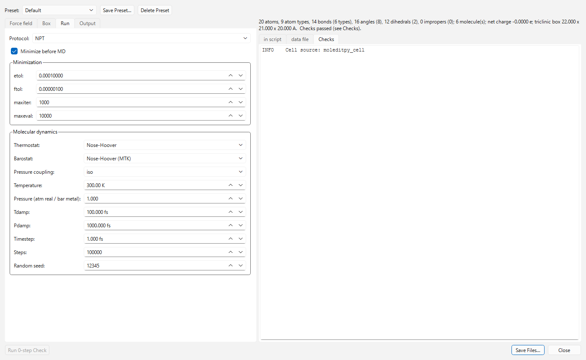

# MoleditPy LAMMPS Input Generator

[](https://github.com/HiroYokoyama/moleditpy_lammps_input_generator/actions/workflows/test.yml)
[](https://github.com/HiroYokoyama/moleditpy_lammps_input_generator/tags)
[](https://github.com/HiroYokoyama/moleditpy_lammps_input_generator/releases)

A [MoleditPy](https://github.com/HiroYokoyama/python_molecular_editor) plugin that
writes a **LAMMPS data file and a matching `in.*` script** for the structure open in
MoleditPy, with a live preview of both files and a list of internal checks before
you save.



## What it does

- **Three force-field sources**
  - **moleditpy-mdff file** (from the Force Field Builder): charges, Lennard-Jones,
    bonds, angles, proper and improper torsions, rigid water and constraints,
    converted from GROMACS units to LAMMPS `real` units
  - **UFF from RDKit**: bonds, angles, torsions and inversions taken from RDKit's UFF
    parameters, with Gasteiger, MMFF94 or zero charges
  - **ReaxFF / other potential**: an `atomic` or `charge` data file plus a script
    template that points at your own potential file (`ffield.*`, `*.eam`, `*.tersoff`, ...)
- **Simulation box** from, in this order:
  1. the `moleditpy_cell` property on the molecule,
  2. the cell of the structure open in the **CIF Viewer** plugin,
  3. a user box: padding around the molecule, or explicit lengths and angles,
     periodic or not.

  Triclinic cells are rotated into the LAMMPS restricted form (`lx ly lz xy xz yz`),
  tilt factors are reduced where LAMMPS would refuse them, and atoms are wrapped
  into the box with image flags that keep molecules whole.
- **Run protocol**: minimization, NVE, NVT or NPT, with Nose-Hoover, Langevin,
  CSVR or Berendsen thermostats and Nose-Hoover or Berendsen barostats
  (iso, aniso, or tri for a triclinic box), an optional minimization before MD,
  SHAKE on bonds to hydrogen, temperature, pressure, timestep, number of steps and
  random seed.
- **Output**: thermo interval, trajectory dump as multi-frame **XYZ with element
  symbols** (opens in the Large System Viewer plugin) or a custom `lammpstrj`,
  restart files, and final `write_data` / `write_restart`.
- **Neighbor list** skin and `neigh_modify every / delay / check`.
- **Presets** saved in the plugin's `settings.json`.
- **Checks**: counts and type ids in the data file are cross-checked, together with
  charge neutrality, box size against the cutoff, SHAKE cluster limits, NPT without
  periodicity and an unusually large timestep.
- **Optional 0-step check**: if `lmp` (or `lmp_serial`, `lmp_mpi`, ...) is on your
  PATH, or you choose the executable, the dialog runs the input with `run 0` in a
  temporary folder and reports LAMMPS errors and warnings.



## Install

Plugin Manager: install from the MoleditPy plugin registry, or drop the
`lammps_input_generator` folder into your MoleditPy plugins directory.

No extra packages are needed: the plugin uses only what MoleditPy already ships
(numpy, RDKit, PySide6).

## Use

**File > Export > LAMMPS Input (data + in script)...**

1. Choose the force-field source on the **Force field** tab.
2. Check the cell on the **Box** tab; the line under the box settings says which
   cell source was used.
3. Set the ensemble and run lengths on the **Run** tab, the dump and restart files on
   the **Output** tab.
4. Read the **Checks** tab, then **Save Files...** (Ctrl+S) and choose a folder.
   Two files are written: `<job>.data` and `in.<job>`. Run them with

   ```
   lmp -in in.<job>
   ```



### Keeping the cell

RDKit does not keep custom molecule properties when MoleditPy takes an undo
snapshot or saves a project, so `moleditpy_cell` can disappear after an edit.
Once the dialog has used a `moleditpy_cell`, the plugin remembers it, saves it in the
project file (`.pmeprj`) and puts it back on the molecule after the project is
loaded.

## Force-field details

### moleditpy-mdff (format version 1)

The file is the JSON written by the Force Field Builder, in GROMACS units (nm,
kJ/mol, degrees, e). The atoms of the open structure must follow the order of the
file's `system` list; if the file holds a single molecule type, the system is
inferred from the atom count.

| mdff | LAMMPS (`real`) |
|---|---|
| bond `k` (kJ/mol/nm^2), `r0` (nm) | `bond_style harmonic`, K = k / 2 / 4.184 / 100, r0 x 10 |
| angle `k` (kJ/mol/rad^2), `theta0` | `angle_style harmonic`, K = k / 2 / 4.184 |
| torsion `k`, `periodicity`, `phase` | `dihedral_style charmm` (weight 0), or `fourier` when a phase is not a whole degree |
| improper with phase 0 or 180 | `improper_style cvff` (d = +1 or -1) |
| other impropers | written as dihedrals |
| `sigma` (nm), `epsilon` (kJ/mol) | x 10, / 4.184 |
| `combination_rule` 2 / 1, 3 | `pair_modify mix arithmetic` / `geometric` |
| `fudge_lj`, `fudge_qq`, `exclusions_nrexcl` | `special_bonds lj 0 0 f coul 0 0 f` |
| `settles`, `constraints` | rigid bonds and angles held by `fix shake` |

When molecule types disagree about `nrexcl`, only types that actually contain 1-3
or 1-4 pairs decide; a real conflict is reported as a warning. Atom types with the
same name but different parameters are split (`CT`, `CT_2`).

An example force field and matching structure are in [`examples/`](examples/).

### UFF

UFF terms follow RDKit's own implementation: harmonic bonds and angles fitted at
the equilibrium angle, torsions divided over the torsions about each bond, umbrella
inversions on sp2 C, N and O (`improper_style umbrella` with omega0 = 0), geometric
mixing and `special_bonds lj/coul 0 0 1`. The cosine angle terms of UFF are
approximated by harmonic ones, so the energies match RDKit near equilibrium, not
far from it. UFF is meant for quick tests, not for production runs.

### Coulomb and k-space

Periodic systems with charges use `lj/cut/coul/long` with `pppm` (or `ewald`);
non-periodic boxes use `lj/cut/coul/cut` and shrink-wrapped boundaries; zero
charges use plain `lj/cut`.

## LAMMPS packages

| Feature | Package |
|---|---|
| `atom_style full`, bonds, angles, `dihedral_style charmm` | MOLECULE |
| `pppm`, `ewald`, `coul/long` | KSPACE |
| `fix shake` | RIGID |
| `improper_style cvff` / `umbrella` | MOLECULE |
| `dihedral_style fourier` | EXTRA-MOLECULE |
| `fix temp/csvr` | EXTRA-FIX |
| `pair_style reaxff`, `fix qeq/reaxff` | REAXFF |

## Development

```
pip install numpy rdkit PySide6-Essentials pytest
python scripts/materialize_shared.py
python -m pytest tests/ -v
```

The shared cell and element modules come from the `_periodic_shared` submodule
(clone with `--recursive`).

## License

LGPL-3.0-or-later. See [LICENSE](LICENSE), [COPYING](COPYING) and
[LICENSING.md](LICENSING.md).
